# Arquitetura da solução

> **Status:** proposta consolidada em 2026-10-17 — aguardando validação do grupo (em especial da Pessoa 1, dona do módulo financeiro).
> Itens marcados **[VALIDAR]** dependem do cliente: o sistema adota o padrão indicado até a resposta, e a regra fica isolada para ser trocada sem refazer o modelo.
>
> Detalhamento dos módulos de processos (auth, usuários, votação, auditoria, notificações, relatórios): [`backend-processos.md`](backend-processos.md).

## 1. Visão geral

Monólito modular em TypeScript: uma API Express organizada por domínio de negócio, um frontend React e um único PostgreSQL.

```text
Navegador
    │  HTTPS (cookie de sessão httpOnly)
    ▼
apps/web — React + Vite ──── /api (REST/JSON, OpenAPI em /api/docs)
                                   │
                                   ▼
apps/api — Express (monólito modular)
    ├── módulos de domínio ── PostgreSQL (dados, sessões, auditoria, fila de e-mail)
    ├── rotinas agendadas ─── encerrar votações vencidas, enviar e-mails pendentes
    ├── Nodemailer ────────── SMTP (Mailpit em desenvolvimento)
    └── Playwright ────────── relatório anual em PDF

Futuro: tarefa persistida no PostgreSQL → worker Playwright (RPA) → SEI
```

### Por que essa forma

| Decisão | Motivo | Descartado |
| --- | --- | --- |
| Monólito modular | Transações financeiras atômicas num só banco; um deploy; equipe de 5 | Microserviços: transação distribuída e vários deploys sem ganho |
| PostgreSQL para tudo (dados, sessão, fila de e-mail) | Um serviço a operar; transações ACID cobrem ação + auditoria + e-mail | Redis e filas externas: só se a carga justificar |
| Rotinas dentro da API lendo estado persistido | Sobrevivem a reinício; `FOR UPDATE SKIP LOCKED` permite várias instâncias | `setTimeout` em memória; worker separado |
| Sessão no servidor | Revogação imediata (logout, desativação, fim de mandato) | JWT: revogação difícil; em `localStorage`, exposto a XSS |

### Como escala sem mudar a arquitetura

A API não guarda estado em memória: sessão, prazos e e-mails pendentes ficam no banco. Portanto é possível rodar duas ou mais instâncias atrás de um proxy reverso sem alterar código. As rotinas usam `FOR UPDATE SKIP LOCKED`, então duas instâncias nunca processam a mesma votação ou o mesmo e-mail. O limite real é o próprio PostgreSQL, muito acima da carga de um departamento.

## 2. Stack

| Área | Tecnologia | Versão em uso / alvo |
| --- | --- | --- |
| Linguagem | TypeScript | 6.x |
| Runtime | Node.js LTS | fixado em `engines` |
| Backend | Express | 5.x |
| Validação e contratos | Zod | 4.x |
| ORM e migrations | Prisma (adapter `pg`) | 7.x |
| Banco | PostgreSQL | 17 |
| Sessão | `express-session` + `connect-pg-simple` | — |
| Senhas | bcrypt (custo 12) | — |
| Documentação da API | OpenAPI gerado dos schemas Zod + Swagger UI | biblioteca confirmada na fundação |
| E-mail | Nodemailer + SMTP (Mailpit em dev) | — |
| PDF | HTML/CSS + Playwright (Chromium) | — |
| Frontend | React + Vite, React Router, TanStack Query, React Hook Form + Zod, Tailwind + shadcn/ui | — |
| Testes | Vitest + Supertest (API), Playwright (E2E) | Vitest 5.x |
| Monorepo | pnpm workspaces | — |
| Ambiente | Docker Compose | — |
| CI | GitHub Actions | — |

## 3. Estrutura do repositório

```text
apps/
    api/
        prisma/                 schema.prisma, migrations/
        src/
            app.ts              monta o Express: middlewares e rotas
            server.ts           sobe o HTTP e as rotinas agendadas
            config/env.ts       valida process.env com Zod (falha no boot se faltar algo)
            shared/             prisma.ts, errors.ts
            middlewares/        authenticate, requirePermission, requestContext, errorHandler
            jobs/               closeExpiredVotings, sendPendingEmails
            modules/<domain>/
                <domain>.routes.ts
                <domain>.controller.ts
                <domain>.service.ts
                <domain>.repository.ts
                <domain>.schemas.ts
                tests/
    web/
        src/                    features/, components/, pages/, services/ (definido pelo frontend)
tests/e2e/                      Playwright
docs/architecture/, docs/decisions/
docker-compose.yml
pnpm-workspace.yaml
.env.example
```

Regras:

- Um arquivo por camada. Quando um módulo crescer, ele pode ser dividido por subconceito (ex.: `budget/approval-limit.service.ts`).
- Repositórios e services recebem `db: Prisma.TransactionClient`, para que várias operações participem da mesma transação. O padrão já está no código da Pessoa 1.
- Um módulo só chama o **service** de outro módulo, nunca o repositório dele.

## 4. Módulos

| Módulo | Responsabilidade | Dono |
| --- | --- | --- |
| `auth` | Login, logout, `me`, definir/redefinir senha por token | P2 |
| `users` | Usuários, atribuições de perfil com vigência, convites | P2 |
| `budget` | Orçamento anual, ajustes, ledger, saldo, limite de aprovação | P1 |
| `categories` | Finalidades de despesa (lista predefinida) | P1 |
| `requests` | Solicitação e sua máquina de estados, avaliação do limite, complementação, cancelamento | P1 |
| `payments` | Registro de pagamento e diferença justificada | P1 |
| `votings` | Votação, votos, desempate, comentários, apuração | P2 |
| `dashboard` | Indicadores agregados | P1 |
| `audit` | Gravar e consultar auditoria | P2 |
| `notifications` | Fila de e-mails (outbox) e envio | P2 |
| `reports` | Relatório anual em PDF | P2 |

Contratos entre módulos (recebem o mesmo `tx`):

```text
audit.record(tx, actor, { action, entity, before?, after?, justification? })     P2 → todos
notifications.enqueue(tx, { template, to, data, dedupeKey })                    P2 → todos
requests.getForVoting(tx, requestId)                                             P1 → P2
requests.markInVoting(tx, requestId, actor)                                      P1 → P2
requests.applyVotingResult(tx, requestId, 'APPROVED' | 'REJECTED', actor)        P1 → P2
budget.getAnnualSummary(year)                                                    P1 → P2 (relatório)
```

`actor` = `{ type: 'USER', userId, ip, requestId }` ou `{ type: 'SYSTEM', job }`.

## 5. Perfis e permissões

Perfis (`Role`): `PROFESSOR`, `HEAD`, `COUNCIL_MEMBER`, `FINANCIAL_ADMIN`.

- Um usuário pode ter vários perfis ao mesmo tempo. Cada perfil é uma atribuição com início e fim de vigência (mandato de chefe = 2 anos).
- As rotas checam **permissões**, nunca perfis. Um único arquivo mapeia perfil → permissões, então incluir ou mudar um perfil altera só esse mapa.
- Regras que dependem do dado ficam no service: dono da solicitação, conselheiro convocado, chefe vigente.

| Permissão | PROFESSOR | COUNCIL_MEMBER | HEAD | FINANCIAL_ADMIN |
| --- | :-: | :-: | :-: | :-: |
| `requests:create`, ver/editar/cancelar as próprias | ✔ | ✔ | ✔ | — |
| `requests:readAll` | — | — | ✔ | ✔ |
| `votings:vote`, `votings:comment` (se convocado) | — | ✔ | — | — |
| `votings:open`, `votings:tieBreak`, `votings:comment`, `requests:requestComplement` | — | — | ✔ | — |
| `budget:manage`, `limits:manage`, `categories:manage` | — | — | ✔ | — |
| `payments:record`, `requests:cancelAny` | — | — | ✔ | — |
| `users:manage` | — | — | ✔ | — |
| `dashboard:read`, `reports:read`, `audit:read` | — | — | ✔ | ✔ |

- **[VALIDAR]** Não há perfil "administrador do sistema": o chefe acumula a administração. O responsável administrativo/financeiro tem só leitura.
- **[VALIDAR]** Quem vê o dashboard além do chefe e do responsável financeiro.

## 6. Ciclo da solicitação

```text
criar ──► avaliação (sob o lock do orçamento)
             ├─ dentro do limite, com saldo ──────► PROVISIONED
             ├─ dentro do limite, sem saldo ──────► AWAITING_BALANCE
             └─ acima do limite ──────────────────► AWAITING_VOTING

AWAITING_VOTING ──chefe pede complemento──► AWAITING_COMPLEMENT ──solicitante edita──► nova avaliação
AWAITING_VOTING ──chefe abre votação──────► IN_VOTING ──resultado──► PROVISIONED | AWAITING_BALANCE | REJECTED
AWAITING_BALANCE ──chefe ajusta o orçamento e provisiona──► PROVISIONED
PROVISIONED ──chefe registra pagamento──► PAID

Cancelar: solicitante (próprias) ou chefe (com justificativa), em qualquer status exceto PAID e REJECTED → CANCELED.
          Se havia provisão, gera RELEASE. Se havia votação aberta, ela vai para CANCELED.
```

| Regra | Decisão |
| --- | --- |
| Status que somam no limite acumulado | Todos exceto `REJECTED` e `CANCELED`. Impede dividir um pedido grande para fugir do conselho. Fica numa constante. **[VALIDAR]** |
| Período do limite | Janela móvel de `periodMonths` contada da data da avaliação (já implementado). **[VALIDAR]** a duração |
| Limite aplicado | O limite vigente na avaliação é gravado na solicitação (`approvalLimitId`) |
| Saldo insuficiente | Aprovação (automática ou por votação) sem saldo vai para `AWAITING_BALANCE`. Não se perde a decisão do conselho. **[VALIDAR]** |
| Edição | O texto pode ser editado até `PAID`. O valor só em `AWAITING_VOTING`/`AWAITING_COMPLEMENT`, o que dispara nova avaliação. Após aprovação, mudar o valor = cancelar e criar outra solicitação. **[VALIDAR]** |
| Complementação durante a votação | O chefe pede, o solicitante edita só o texto; o status não muda e o valor fica travado |
| Virada do ano | A solicitação pertence ao orçamento do ano em que foi criada. **[VALIDAR]** o que acontece com o provisionado em 31/12 |

## 7. Regras financeiras (ledger)

Disponível, provisionado e utilizado **não são colunas**: são somas de `LedgerEntry`, uma tabela só de inclusão.

```text
total        = Budget.initialAmount + Σ ADJUSTMENT_IN − Σ ADJUSTMENT_OUT
available    = total − Σ PROVISION + Σ RELEASE
provisioned  = Σ PROVISION − Σ RELEASE − Σ SPEND
spent        = Σ SPEND
```

| Operação | Lançamentos |
| --- | --- |
| Ajuste manual do orçamento | `ADJUSTMENT_IN` ou `ADJUSTMENT_OUT` (exige justificativa; `ADJUSTMENT_OUT` ≤ disponível) |
| Aprovação | `PROVISION(amount)` |
| Cancelamento de solicitação provisionada | `RELEASE(provisionado)` |
| Pagamento igual ao provisionado | `SPEND(pago)` |
| Pagamento menor | `SPEND(pago)` + `RELEASE(provisionado − pago)`, com justificativa |
| Pagamento maior | `PROVISION(pago − provisionado)` (exige saldo) + `SPEND(pago)`, com justificativa |

Garantias:

- Toda operação que lê saldo e grava lançamento abre a transação com `SELECT … FOR UPDATE` na linha do `Budget` (`budgetRepository.lock`). Isso serializa as operações financeiras e impede que duas aprovações simultâneas estourem o saldo. A avaliação do limite roda dentro do mesmo lock. Esse lock global é proposital: na escala de um departamento, o custo é desprezível.
- O banco recusa `UPDATE`/`DELETE` em `LedgerEntry` e `AuditLog` (trigger) e exige valores > 0 (`CHECK`). O efeito do lançamento vem do `type`, nunca do sinal.
- `Payment.requestId` é único, então não existe pagamento duplicado em retry.
- Lançamento, mudança de status, auditoria e e-mail ficam na mesma transação.

## 8. Modelo de dados

Convenções do schema Prisma:

- Models em inglês, PascalCase singular; campos em camelCase; sem `@map`.
- Dinheiro em `Decimal @db.Decimal(14, 2)`.
- Datas em `DateTime @db.Timestamptz(3)`, gravadas em UTC.
- IDs `Int @default(autoincrement())`.
- Regras que o Prisma não expressa (CHECK, triggers, índice único parcial) ficam em SQL na migration.

```mermaid
erDiagram
    User ||--o{ RoleAssignment : "tem"
    User ||--o{ PasswordToken : "tem"
    User ||--o{ Request : "solicita"
    ExpenseCategory ||--o{ Request : "classifica"
    Budget ||--o{ Request : "financia"
    ApprovalLimit ||--o{ Request : "avaliou"
    Budget ||--o{ LedgerEntry : "movimenta"
    Request |o--o{ LedgerEntry : "origina"
    Request ||--o| Payment : "paga"
    Request ||--o{ ComplementRequest : "recebe"
    Request ||--o{ Voting : "delibera"
    Voting ||--o{ VotingEligibleMember : "convoca"
    User ||--o{ VotingEligibleMember : "convocado"
    VotingEligibleMember ||--o| Vote : "registra"
    Voting ||--o| TieBreak : "desempata"
    Voting ||--o{ VotingComment : "contém"
    User ||--o{ VotingComment : "escreve"
    User |o--o{ AuditLog : "executa"

    User {
        int id PK
        string name
        string email UK "minúsculo"
        string passwordHash "nulo até aceitar o convite"
        boolean active
        datetime createdAt
    }
    RoleAssignment {
        int id PK
        int userId FK
        enum role "PROFESSOR | HEAD | COUNCIL_MEMBER | FINANCIAL_ADMIN"
        datetime startsAt
        datetime endsAt "nulo = vigente"
        int assignedById FK
    }
    PasswordToken {
        int id PK
        int userId FK
        string tokenHash UK
        enum purpose "INVITE | RESET"
        datetime expiresAt
        datetime usedAt
    }
    Budget {
        int id PK
        int year UK
        decimal initialAmount
        int createdById FK
        datetime createdAt
    }
    ApprovalLimit {
        int id PK
        decimal amount
        int periodMonths
        datetime validFrom
        datetime validUntil "nulo = vigente"
        int createdById FK
    }
    ExpenseCategory {
        int id PK
        string name UK
        boolean active
    }
    Request {
        int id PK
        int requesterId FK
        int categoryId FK
        int budgetId FK
        int approvalLimitId FK
        string description
        decimal amount
        enum status
        datetime createdAt
        datetime updatedAt
    }
    LedgerEntry {
        int id PK
        int budgetId FK
        int requestId FK "nulo em ajuste manual"
        enum type "ADJUSTMENT_IN | ADJUSTMENT_OUT | PROVISION | RELEASE | SPEND"
        decimal amount "> 0"
        string justification
        int createdById FK "nulo = sistema"
        datetime createdAt
    }
    Payment {
        int id PK
        int requestId FK,UK
        int recordedById FK
        decimal paidAmount
        string justification "obrigatória se diferente do provisionado"
        datetime paidAt
    }
    ComplementRequest {
        int id PK
        int requestId FK
        int requestedById FK
        string message
        datetime createdAt
    }
    Voting {
        int id PK
        int requestId FK
        int openedById FK
        datetime openedAt
        datetime deadline
        enum status "OPEN | AWAITING_TIE_BREAK | CLOSED | CANCELED"
        enum result "APPROVED | REJECTED"
        int approveCount
        int rejectCount
        int abstainCount
        datetime closedAt
    }
    VotingEligibleMember {
        int votingId PK,FK
        int userId PK,FK
    }
    Vote {
        int votingId PK,FK
        int userId PK,FK
        enum choice "APPROVE | REJECT | ABSTAIN"
        datetime createdAt
    }
    TieBreak {
        int votingId PK,FK
        int headId FK
        enum choice "APPROVE | REJECT"
        datetime createdAt
    }
    VotingComment {
        int id PK
        int votingId FK
        int authorId FK
        string body "até 2000 caracteres"
        datetime createdAt
    }
    AuditLog {
        int id PK
        datetime occurredAt
        enum actorType "USER | SYSTEM"
        int actorId FK
        string action
        string entityType
        string entityId
        json before
        json after
        string justification
        string ip
        string requestId
    }
    EmailOutbox {
        int id PK
        string dedupeKey UK
        string toEmail
        string template
        json data
        enum status "PENDING | SENT | FAILED"
        int attempts
        datetime nextAttemptAt
        string lastError
        datetime sentAt
    }
    Session {
        string sid PK
        json sess
        datetime expire
    }
```



`RequestStatus`: `AWAITING_VOTING`, `AWAITING_COMPLEMENT`, `AWAITING_BALANCE`, `IN_VOTING`, `PROVISIONED`, `PAID`, `REJECTED`, `CANCELED`.

Garantias no banco:

| Regra | Mecanismo |
| --- | --- |
| Um voto por conselheiro por votação; imutável | PK `(votingId, userId)` em `Vote`; sem rota de alteração |
| Só convocado vota | FK `(votingId, userId)` → `VotingEligibleMember` |
| Uma votação não encerrada por solicitação | Índice único parcial `WHERE status IN ('OPEN','AWAITING_TIE_BREAK')` (SQL) |
| Um desempate por votação | PK `votingId` em `TieBreak` |
| Um pagamento por solicitação | Unique `Payment.requestId` |
| Ledger e auditoria só de inclusão | Trigger recusa `UPDATE`/`DELETE` |
| Valores positivos | `CHECK (amount > 0)` em `Request`, `LedgerEntry`, `Payment` e `ApprovalLimit` |
| E-mail sem duplicata | Unique `EmailOutbox.dedupeKey` + `ON CONFLICT DO NOTHING` |
| Histórico não é apagado | FKs com `ON DELETE RESTRICT`; usuário é desativado, nunca removido |

`Session` segue o formato do `connect-pg-simple` (`@@map("session")`) e fica no schema para o Prisma não acusar drift.

## 9. Segurança

| Ameaça | Controle |
| --- | --- |
| Roubo de sessão / XSS | Cookie `httpOnly`, `Secure` em produção, `SameSite=Lax`; id regenerado no login; expiração por inatividade (~8 h); React escapa a saída |
| CSRF | `SameSite=Lax` + API só aceita `application/json` + CORS restrito à origem do frontend |
| Força bruta | Limite de tentativas no login (`express-rate-limit`); bcrypt custo 12; mensagem genérica de falha |
| Enumeração de e-mails | "Esqueci a senha" sempre responde 200 |
| Acesso indevido | `authenticate` + `requirePermission` em toda rota protegida; regra por dado no service; perfis lidos do banco a cada requisição |
| Entrada maliciosa | Zod em body, params e query; Prisma parametriza as queries (`$queryRawUnsafe` proibido) |
| Vazamento em erro | `errorHandler` responde `{ error: { code, message } }`; stack só no log técnico |
| Cabeçalhos | `helmet` |
| Segredos | Só em `.env` (fora do Git); `.env.example` sem valores; `config/env.ts` valida no boot |
| Tokens de convite/reset | Só o hash é guardado; uso único; expiração |
| Adulteração do histórico | Ledger e auditoria só de inclusão no banco; auditoria na mesma transação |
| Dependências | Dependabot + `pnpm audit` no CI |
| Privilégio no banco | Recomendado: usuário da aplicação sem DDL; migrations rodam com outro usuário |
| Anexos | Fora da v1. Se entrarem: volume fora do webroot, metadados no banco, MIME e tamanho limitados, download só por rota autorizada |

## 10. Erros, logs e observabilidade

- Erros de domínio (`AppError` com `status` e `code`, já em `shared/errors.ts`).
- O `errorHandler` traduz: Zod → 400, sem permissão → 403, não encontrado → 404, conflito/estado inválido (inclui Prisma `P2002`) → 409, regra de negócio → 422, desconhecido → 500 com `requestId`.
- Log técnico em JSON no stdout com `requestId` em toda linha. É separado da auditoria funcional.

## 11. Ambiente, CI e fluxo de trabalho

- **Docker Compose (dev):**
  - `db` (PostgreSQL 17, healthcheck, volume) — já existe;
  - `mailpit`;
  - `api` e `web` com hot reload.
  - Credenciais vêm do `.env`.
- **`.env.example`:** `DATABASE_URL`, `SESSION_SECRET`, `SMTP_HOST`, `SMTP_PORT`, `SMTP_USER`, `SMTP_PASS`, `MAIL_FROM`, `APP_URL`, `CORS_ORIGIN`.
- **GitHub Actions (PR e push na `main`):** pnpm/Node com cache → `install --frozen-lockfile` → lint → tipos → `prisma migrate deploy` num PostgreSQL de serviço → testes → build. O E2E Playwright roda num job separado.
- **Fluxo:**
  1. Cartão no Trello.
  2. Branch `feat/<assunto>`.
  3. PR linkando o cartão.
  4. Revisão de outra pessoa (regra financeira: os dois do backend).
  5. CI verde.
  6. Merge.
  - A `main` fica protegida.
  - Essa trilha é a evidência de "planejado → executado → concluído" pedida na Fase 2.

## 12. Testes

- **Unitários:** apuração da votação (inclui 0×0 e só abstenções), cálculo do saldo, mapa de permissões, espera entre tentativas de e-mail.
- **Integração (PostgreSQL real, banco recriado no CI):**
  - limite acumulado e aprovação automática;
  - concorrência de aprovações;
  - cancelamento → `RELEASE`;
  - pagamento menor e maior;
  - voto duplo → 409;
  - voto após o prazo → 422;
  - 403 por perfil;
  - rotina de encerramento executada 2× → uma provisão;
  - desempate;
  - comentários invisíveis ao solicitante;
  - falha forçada desfaz ação e auditoria;
  - trigger bloqueia `UPDATE` no ledger e na auditoria.
- **E2E:** os fluxos mínimos de `entrega-fase-1/prototipos/README.md`.
- Funções com regra de tempo recebem `now` como parâmetro.

## 13. Alinhamento do código existente

O código atual (`apps/api`, Pessoa 1) segue a direção correta: ledger, lock no orçamento, CHECK, trigger e repositórios com `tx`. Mudanças para chegar a este documento:

| Hoje | Alvo |
| --- | --- |
| Identificadores em português (`Usuario`, `Solicitacao`, `criarOrcamento`) | Inglês (`User`, `Request`, `createBudget`); mensagens ao usuário continuam em pt-BR |
| `modules/financeiro/{repositories,services}` | `modules/budget`, `modules/requests`, `modules/payments`, `modules/categories` |
| `Usuario.senhaHash` obrigatório, sem perfis | `User.passwordHash` opcional + `RoleAssignment` |
| `CRIADA`, `AGUARDANDO_COMPLEMENTO`, `EM_VOTACAO`, `PROVISIONADA`, `PAGA`, `REJEITADA`, `CANCELADA` | `RequestStatus` da seção 8 (inclui `AWAITING_VOTING` e `AWAITING_BALANCE`) |
| `AJUSTE_POSITIVO`, `AJUSTE_NEGATIVO`, `PROVISAO`, `ESTORNO`, `UTILIZACAO` | `ADJUSTMENT_IN`, `ADJUSTMENT_OUT`, `PROVISION`, `RELEASE`, `SPEND` |
| Schema com `Solicitacao.descricao`, migration sem a coluna | Corrigido na nova migration |
| `finalidade` (texto) + `categoriaId` | Só `categoryId` (a lista de finalidades) + `description` |
| `Movimentacao` sem autor e justificativa | `createdById` e `justification` |
| `DateTime` sem fuso | `@db.Timestamptz(3)` |
| `Movimentacao.solicitacaoId` com `ON DELETE SET NULL` | `RESTRICT` |
| `STATUS_QUE_CONTAM_NO_LIMITE` sem os status de espera | Todos exceto `REJECTED`/`CANCELED` |
| npm + `package-lock.json` | pnpm workspaces |
| Testes sobre um banco compartilhado | Banco de teste recriado antes da suíte |

Como ainda não há dados reais, a migration inicial pode ser **recriada** (`prisma migrate reset`) em vez de renomeada passo a passo. O SQL manual (CHECK e triggers) é mantido e estendido para `AuditLog`.

## 14. Pendências com o cliente e padrão provisório

| Pendência | Padrão adotado até a resposta |
| --- | --- |
| Duração do período do limite | Configurável no `ApprovalLimit`; sugerir 12 meses |
| Status que entram no acumulado | Todos exceto rejeitadas e canceladas |
| Votação sem votos ou só com abstenções | Desempate do chefe |
| Saldo insuficiente | `AWAITING_BALANCE` |
| Edição após aprovação | Só texto; valor = cancelar e criar outra |
| Administrador do sistema | Não existe; o chefe administra |
| Permissões do responsável financeiro | Somente leitura |
| Campos e anexos obrigatórios | Categoria, valor e descrição; anexos fora da v1 |
| Notificações dentro da plataforma | Fora da v1 (só e-mail) |
| Modelo oficial do PDF | Template HTML provisório |
| Provisionado na virada do ano | Permanece no orçamento do ano de origem |
