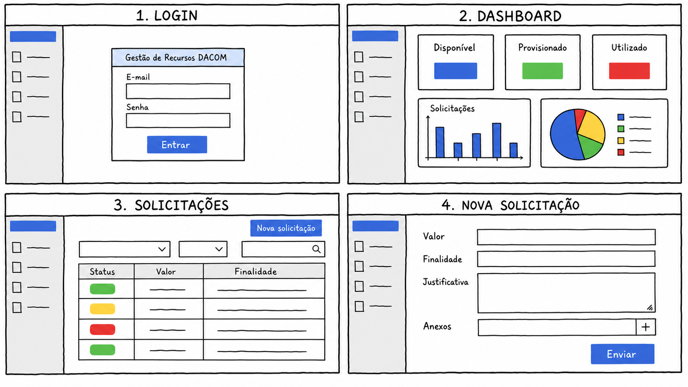
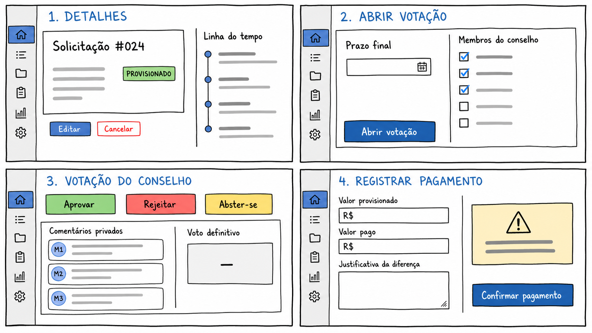
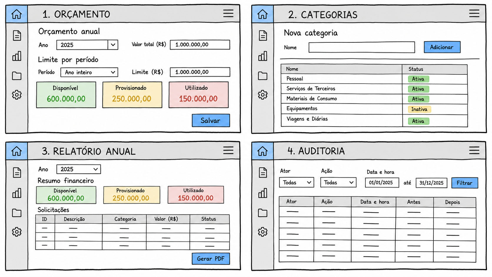

# Plataforma de Gestão de Recursos Financeiros do DACOM

## Documento da Fase 1

| Identificação | Informação |
| --- | --- |
| Instituição | Universidade Tecnológica Federal do Paraná — UTFPR |
| Curso | [PREENCHER] |
| Disciplina | [PREENCHER] |
| Professor da disciplina | [PREENCHER] |
| Cliente | Prof. Lucas Sampaio |
| Equipe | [PREENCHER COM OS CINCO INTEGRANTES] |
| Data | [PREENCHER] |
| Versão | 0.1 — rascunho inicial |

## 1. Introdução

Este documento apresenta o entendimento do negócio, os requisitos levantados com o cliente e a proposta inicial de uma solução computacional para a gestão dos recursos financeiros do DACOM.

A proposta consiste em uma plataforma web capaz de centralizar solicitações, automatizar parte das aprovações, apoiar a deliberação do Conselho Departamental, controlar recursos provisionados e utilizados e gerar informações para acompanhamento e prestação de contas.

O projeto encontra-se na etapa de levantamento e desenho da solução. As telas apresentadas nesta fase serão protótipos e a arquitetura poderá receber ajustes após a validação do cliente, sem alterar as regras já confirmadas.

## 2. Metodologia de levantamento

O grupo analisou a proposta inicial e preparou um questionário organizado em quinze temas:

1. Usuários e níveis de acesso;
2. Solicitação de recursos;
3. Limite para aprovação automática;
4. Processo de votação;
5. Discussões durante a votação;
6. Estados dos recursos;
7. Finalização e pagamento;
8. Categorias e finalidades;
9. Dashboard e relatórios;
10. Prestação de contas;
11. Histórico e auditoria;
12. Notificações;
13. Dados financeiros e integrações;
14. Orçamento disponível;
15. Fluxo atual.

O cliente respondeu ao levantamento por e-mail. As respostas foram consolidadas neste documento e preservadas em [`anexos/levantamento-cliente.md`](anexos/levantamento-cliente.md).

## 3. Entendimento do negócio

### 3.1 Problema atual

O departamento não dispõe atualmente de um sistema próprio para controlar os recursos já comprometidos. Existe apenas o extrato da UGR do DACOM, que apresenta as movimentações efetivadas, mas não considera valores provisionados.

Essa limitação dificulta identificar o saldo realmente livre, porque uma solicitação pode ter sido aprovada sem que o pagamento tenha acontecido. O valor ainda aparece no extrato, embora já esteja comprometido.

O processo também envolve diferentes pessoas, decisões do Conselho Departamental e a necessidade de rastrear alterações. A descentralização dessas informações torna o acompanhamento, a comunicação e a prestação de contas mais trabalhosos.

### 3.2 Estados dos recursos

Os recursos são classificados em três estados:

- **Disponível:** parcela do orçamento que ainda não está comprometida;
- **Provisionado:** valor reservado por uma solicitação aprovada, mas ainda não pago;
- **Utilizado:** valor cujo pagamento ou prestação de contas foi registrado pelo chefe.

O sistema deverá manter a consistência entre esses estados. Uma aprovação reduz o disponível e aumenta o provisionado. Um pagamento reduz o provisionado e aumenta o utilizado. Um cancelamento ou valor não utilizado retorna ao disponível.

### 3.3 Atores

| Ator | Participação |
| --- | --- |
| Professor solicitante | Cria, acompanha, edita e cancela solicitações enquanto não estiverem pagas |
| Chefe do departamento | Configura limites, abre votações, define prazos, desempata, administra categorias e registra pagamentos |
| Membro do Conselho | Analisa solicitações, comenta e vota quando uma deliberação é aberta |
| Responsável administrativo/financeiro | Perfil reconhecido pelo cliente, com permissões operacionais ainda pendentes de detalhamento |
| Administrador do sistema | Mencionado na configuração do limite; existência como perfil independente ainda precisa ser confirmada |

Professor, chefe e conselheiro também podem atuar como solicitantes. Um usuário poderá possuir mais de um perfil.

### 3.4 Fluxo de negócio

```text
Solicitação criada
    │
    ▼
Verificação do saldo e do limite acumulado
    │
    ├── Dentro do limite ──► aprovação automática
    │
    └── Acima do limite ──► votação aberta pelo chefe
                                  │
                                  ├── Rejeitada ──► saldo permanece disponível
                                  │
                                  └── Aprovada
                                          │
                                          ▼
                                     provisionamento
                                          │
                            ┌─────────────┴─────────────┐
                            │                           │
                         cancelamento               pagamento
                            │                           │
                            ▼                           ▼
                  retorno ao disponível         valor utilizado
```

## 4. Requisitos levantados

### 4.1 Requisitos funcionais

| Código | Requisito |
| --- | --- |
| RF01 | Autenticar os usuários da plataforma |
| RF02 | Permitir que um usuário possua mais de um perfil |
| RF03 | Controlar as permissões de solicitante, chefe, conselheiro e responsável administrativo/financeiro |
| RF04 | Cadastrar manualmente o orçamento geral no início de cada ano |
| RF05 | Permitir atualizações manuais do orçamento |
| RF06 | Permitir que o chefe cadastre categorias ou finalidades de despesa |
| RF07 | Permitir a criação e o acompanhamento de solicitações |
| RF08 | Permitir edição e cancelamento enquanto a solicitação não estiver paga |
| RF09 | Calcular o total acumulado solicitado pelo professor no período |
| RF10 | Aprovar automaticamente solicitações que permaneçam dentro do limite |
| RF11 | Encaminhar para deliberação solicitações que ultrapassem o limite |
| RF12 | Permitir que o chefe abra a votação e defina seu prazo |
| RF13 | Permitir votos de aprovação, rejeição ou abstenção |
| RF14 | Impedir a alteração de um voto já registrado |
| RF15 | Permitir comentários privados entre conselheiros e chefe |
| RF16 | Preservar permanentemente os comentários no histórico |
| RF17 | Consolidar os votos e registrar o resultado ao final do prazo |
| RF18 | Permitir que o chefe registre um voto de desempate |
| RF19 | Provisionar imediatamente o valor de uma solicitação aprovada |
| RF20 | Retornar ao disponível o valor de uma solicitação cancelada ou não paga |
| RF21 | Permitir que o chefe registre o pagamento ou a prestação de contas |
| RF22 | Permitir ajuste do valor pago mediante justificativa do chefe |
| RF23 | Apresentar dashboard com indicadores financeiros e operacionais |
| RF24 | Gerar relatório anual em PDF para o ano selecionado |
| RF25 | Enviar notificações por e-mail |
| RF26 | Registrar ações, alterações, votos, pagamentos e mudanças de status para auditoria |

### 4.2 Requisitos não funcionais propostos

Os requisitos abaixo decorrem do tipo de sistema e da proposta técnica. Eles deverão ser revisados com o cliente quando necessário.

| Código | Requisito |
| --- | --- |
| RNF01 | A aplicação deverá ser acessível por navegador e adaptar-se a diferentes tamanhos de tela |
| RNF02 | As permissões deverão ser verificadas no servidor |
| RNF03 | Senhas e dados sensíveis não poderão ser armazenados em texto puro |
| RNF04 | Operações financeiras relacionadas deverão ser processadas de forma transacional |
| RNF05 | Valores monetários deverão manter precisão decimal |
| RNF06 | O histórico de auditoria deverá preservar a identificação do ator e o momento da ação |
| RNF07 | A API deverá possuir documentação OpenAPI |
| RNF08 | O código deverá ser modular, testável e de fácil manutenção |
| RNF09 | O ambiente deverá ser reproduzível por meio de contêineres |
| RNF10 | A interface deverá considerar acessibilidade, mensagens de erro e confirmações para ações críticas |

## 5. Regras de negócio confirmadas

| Código | Regra |
| --- | --- |
| RN01 | O limite de aprovação pode mudar ao longo do tempo |
| RN02 | O limite é acumulado por professor dentro de um período |
| RN03 | Ultrapassar o limite acumulado exige análise do Conselho |
| RN04 | Somente o chefe inicia a votação e define o prazo |
| RN05 | Não existe prazo padrão nem quórum mínimo |
| RN06 | A decisão ocorre por maioria simples |
| RN07 | O chefe não vota normalmente e atua apenas em caso de empate |
| RN08 | O voto é público no processo de deliberação |
| RN09 | Um voto registrado é definitivo |
| RN10 | Comentários da votação são restritos aos conselheiros e ao chefe |
| RN11 | O solicitante complementa informações editando o pedido quando solicitado pelo chefe |
| RN12 | A aprovação move imediatamente o valor para provisionado |
| RN13 | O chefe é responsável por registrar o pagamento |
| RN14 | O pagamento não exige comprovante nem validação adicional |
| RN15 | Uma diferença entre valor provisionado e pago exige justificativa |
| RN16 | Somente o chefe administra a lista de finalidades |
| RN17 | Existe apenas um saldo geral, sem divisão por fonte ou categoria |
| RN18 | O orçamento é cadastrado manualmente e pode receber atualizações |
| RN19 | O relatório exigido no escopo atual é anual e em PDF |
| RN20 | Deve ser registrado o máximo possível para auditoria |

## 6. Escopo

### 6.1 Dentro do escopo

- Gestão de usuários e perfis;
- Cadastro e atualização do orçamento geral;
- Categorias de despesas;
- Solicitações e acompanhamento;
- Aprovação automática por limite;
- Deliberação, comentários e votação;
- Provisionamento, cancelamento e pagamento;
- Dashboard;
- Relatório anual em PDF;
- Notificações por e-mail;
- Auditoria das ações.

### 6.2 Fora do escopo atual

- Execução real de transferências bancárias;
- Substituição do processo burocrático do SEI;
- Integração imediata com o SEI;
- Importação de banco de dados ou planilha legada;
- Controle de diferentes fontes de orçamento;
- Relatórios mensais, semestrais ou por período personalizado;
- Aplicativo móvel nativo.

## 7. Proposta de solução

Propõe-se uma plataforma web responsiva, acessível por navegador. O frontend apresentará telas específicas conforme os perfis do usuário. O backend concentrará as regras de negócio, permissões, transações financeiras, auditoria e integrações.

A solução será construída como um **monólito modular**. Haverá uma única aplicação backend, organizada internamente por domínios. Essa arquitetura reduz a complexidade de implantação e, ao mesmo tempo, mantém separadas as principais responsabilidades.

### 7.1 Stack

| Área | Tecnologia |
| --- | --- |
| Linguagem | TypeScript |
| Frontend | React com Vite |
| Navegação | React Router |
| Dados remotos | TanStack Query |
| Formulários | React Hook Form e Zod |
| Interface | Tailwind CSS e shadcn/ui |
| Backend | Node.js com Express |
| API | REST com OpenAPI/Swagger |
| Banco de dados | PostgreSQL |
| ORM | Prisma |
| E-mail | Nodemailer com SMTP |
| Relatório PDF | HTML/CSS com Playwright |
| Testes | Vitest, Supertest e Playwright |
| Monorepo | pnpm workspaces |
| Ambiente | Docker Compose |
| Integração contínua | GitHub Actions |

### 7.2 Arquitetura inicial

```text
Usuário
    │
    ▼
React + Vite
    │
    │ REST / JSON / OpenAPI
    ▼
Node.js + Express
    ├── autenticação e perfis
    ├── orçamento e solicitações
    ├── votação e comentários
    ├── pagamentos e auditoria
    ├── dashboard e relatórios
    └── notificações
            │
            ├── PostgreSQL
            ├── servidor SMTP
            ├── armazenamento de anexos
            └── geração de PDF

Integração futura:
Express ──► tarefa persistida ──► worker Playwright ──► SEI
```

### 7.3 Módulos previstos

- Autenticação;
- Usuários e perfis;
- Orçamento;
- Categorias;
- Solicitações;
- Votações;
- Comentários;
- Pagamentos;
- Anexos;
- Notificações;
- Dashboard;
- Relatórios;
- Auditoria.

## 8. Interoperabilidade

### 8.1 Entrada de dados

- Formulários preenchidos pelos usuários;
- Cadastro e atualizações manuais do orçamento;
- Votos e comentários;
- Registro de pagamentos e justificativas;
- Documentos anexados, caso sejam confirmados como necessários.

### 8.2 Saída de dados

- Dashboard;
- Acompanhamento das solicitações;
- Histórico e auditoria;
- Notificações por e-mail;
- Relatório anual em PDF.

### 8.3 Integrações

Na primeira versão, a principal integração externa será o servidor SMTP usado para e-mails. Não existe uma base financeira anterior para importação.

O trâmite oficial continuará no SEI. Futuramente, um worker de RPA poderá consumir tarefas persistidas pela plataforma e automatizar partes desse processo com Playwright. Essa automação não faz parte da entrega inicial e será detalhada somente quando o fluxo do SEI for conhecido.

## 9. Protótipos

As telas inicialmente previstas são:

1. Login;
2. Dashboard;
3. Lista de solicitações;
4. Criação e edição de solicitação;
5. Detalhes e histórico da solicitação;
6. Abertura de votação;
7. Votação e comentários;
8. Administração do orçamento;
9. Administração das categorias;
10. Registro de pagamento;
11. Relatório anual;
12. Usuários e perfis;
13. Auditoria.

O link do Figma e as imagens exportadas deverão ser adicionados na seção de protótipos antes da entrega.

### 9.1 Rascunhos de baixa fidelidade

As pranchas abaixo foram criadas deliberadamente com aparência de desenho no Windows Paint. Elas apresentam hierarquia, campos e ações sugeridas, mas não representam a identidade visual final. O grupo deverá usá-las como ponto de partida para os componentes e fluxos no Figma. Anos, valores, categorias e registros exibidos são dados meramente ilustrativos e não definem novas regras de negócio.

#### Acesso, dashboard e solicitações



#### Deliberação e pagamento



#### Administração, relatório e auditoria



## 10. Ambientes colaborativos

| Finalidade | Ambiente | Endereço |
| --- | --- | --- |
| Código, versionamento e revisão | GitHub | https://github.com/https-pelaquin/projeto-certificadora-competencia-especifica |
| Planejamento e acompanhamento | Trello | https://trello.com/b/xcfNnJ1w/projeto-certificadora-de-competencia-espec%C3%ADfica |
| Documento compartilhado | [PREENCHER] | [PREENCHER] |
| Protótipos | Figma — proposto | [PREENCHER] |
| Comunicação do grupo | [PREENCHER] | [PREENCHER] |

As instruções de acesso estão em [`anexos/ambientes-e-acessos.md`](anexos/ambientes-e-acessos.md).

## 11. Organização da equipe

A divisão abaixo é uma proposta inicial e deverá ser preenchida com os nomes e confirmada pelo grupo.

| Integrante | Responsabilidade principal | Responsabilidade secundária |
| --- | --- | --- |
| [PREENCHER] | Backend financeiro: orçamento, solicitações, provisionamento e pagamento | Modelagem do banco e revisão das regras financeiras |
| [PREENCHER] | Backend de processos: autenticação, votação, auditoria e notificações | API, Docker e integração contínua |
| [PREENCHER] | Frontend base: layout, autenticação e solicitações | Protótipos e acessibilidade |
| [PREENCHER] | Frontend operacional: votação, categorias e pagamentos | Integração com a API |
| [PREENCHER] | Frontend analítico: dashboard, relatórios e histórico | Coordenação dos testes de fluxo |

Cada integrante continuará responsável pelos testes da sua funcionalidade. Pull requests deverão ser revisados por outra pessoa e funcionalidades serão desenvolvidas verticalmente, integrando backend e frontend.

## 12. Planejamento preliminar

| Etapa | Objetivo |
| --- | --- |
| Conclusão da Fase 1 | Validar requisitos, produzir protótipos, finalizar documento e gravar o vídeo |
| Fundação técnica | Criar monorepo, banco, autenticação, perfis, ambiente Docker e integração contínua |
| Fluxo de solicitações | Implementar orçamento, categorias, solicitação, limite e provisionamento |
| Deliberação | Implementar votação, comentários, encerramento e notificações |
| Execução financeira | Implementar cancelamento, pagamento, diferenças e auditoria |
| Informação gerencial | Implementar dashboard e relatório anual |
| Estabilização | Executar testes completos, corrigir problemas, revisar segurança e preparar implantação |

As datas, responsáveis e cartões correspondentes deverão ser registrados no Trello conforme o calendário oficial da disciplina.

## 13. Riscos identificados

- Regras pendentes podem alterar o cálculo do limite e a votação;
- Dois integrantes com preferência por backend podem se tornar um gargalo para três frentes de interface;
- A geração de PDF precisa reproduzir um modelo oficial ainda não recebido;
- O armazenamento de anexos ainda não foi definido;
- E-mail e ambiente de implantação dependem de infraestrutura ainda não informada;
- A futura integração com o SEI depende do detalhamento do processo institucional;
- Falta de revisão contínua pode gerar divergência entre documento, protótipo e implementação.

## 14. Questões pendentes

- Qual é a duração exata do período usado no limite acumulado?
- Quais solicitações entram no acumulado?
- Uma edição após aprovação exige nova análise ou votação?
- Quais campos e documentos são obrigatórios?
- O que acontece quando não há votos?
- Como tratar uma votação composta apenas por abstenções?
- Como o sistema deve agir quando o saldo é insuficiente?
- Quais são as permissões do responsável administrativo/financeiro?
- Existe um administrador separado do chefe?
- Também existirão notificações dentro da plataforma?
- Onde os anexos serão armazenados?
- Qual documento oficial da UTFPR servirá de referência para o PDF?

## 15. Validação do cliente

| Item | Situação |
| --- | --- |
| Entendimento do problema | [VALIDAR] |
| Requisitos consolidados | [VALIDAR] |
| Fluxo proposto | [VALIDAR] |
| Protótipos | [VALIDAR] |
| Arquitetura e tecnologias | [VALIDAR] |
| Escopo da primeira versão | [VALIDAR] |

Registrar nesta seção a data, o meio e o resultado da validação da proposta pelo cliente.

## 16. Conclusão

A proposta busca substituir um controle que hoje não contempla valores provisionados por uma plataforma centralizada e auditável. A arquitetura escolhida utiliza tecnologias conhecidas pela equipe e evita complexidade operacional desnecessária.

A solução permitirá acompanhar todo o ciclo da solicitação, desde o cadastro até o pagamento, preservando as decisões do Conselho e oferecendo informações consolidadas para gestão e prestação de contas. Os próximos passos são resolver as dúvidas pendentes, criar os protótipos, configurar os ambientes colaborativos e validar a proposta com o cliente.
