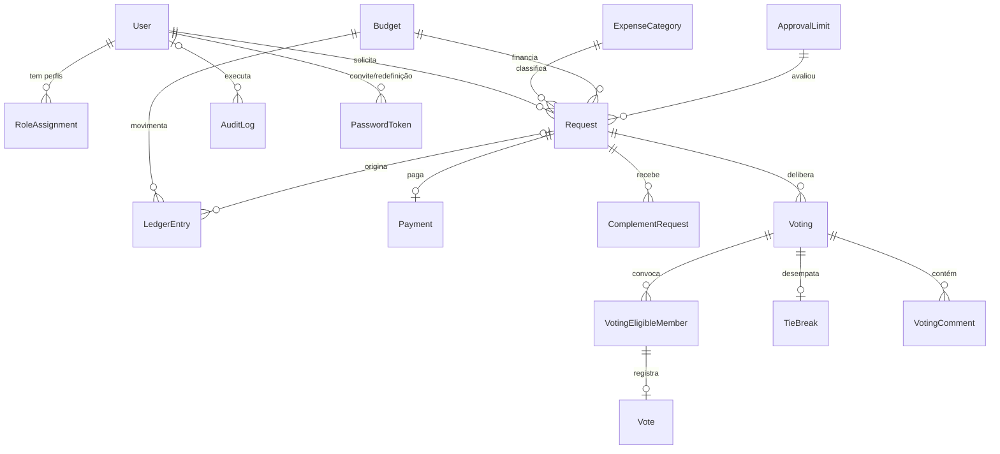

# Plataforma de Gestão de Recursos Financeiros do DACOM

## Documento da Fase 2 — Andamento do desenvolvimento

| Identificação | Informação |
| --- | --- |
| Instituição | Universidade Tecnológica Federal do Paraná — UTFPR |
| Curso | [PREENCHER] |
| Disciplina | [PREENCHER] |
| Professor da disciplina | [PREENCHER] |
| Cliente | Prof. Lucas Sampaio |
| Equipe | [PREENCHER COM OS CINCO INTEGRANTES] |
| Data | [PREENCHER] |
| Versão | 0.1 — rascunho |

## 1. Introdução

Este documento apresenta o estado atual do desenvolvimento da plataforma proposta na Fase 1 e as evidências da evolução do trabalho. A plataforma centraliza solicitação, aprovação, votação, provisionamento, pagamento e prestação de contas dos recursos do DACOM.

Desde a Fase 1, o grupo:

- enviou a proposta consolidada ao cliente para validação formal;
- evoluiu os protótipos de baixa fidelidade para o layout no Figma;
- consolidou a arquitetura e o modelo de dados;
- iniciou a implementação pelo backend financeiro, a parte de maior risco do sistema.

Ao longo do texto, o que está **implementado** fica separado do que está **projetado**. Os itens que dependem de resposta do cliente estão marcados como **[VALIDAR]**.

## 2. Resumo do andamento

| Frente | Planejado para esta etapa | Situação | Evidência |
| --- | --- | --- | --- |
| Backend financeiro (Pessoa 1) | Banco, orçamento, saldo, limite acumulado | **Em desenvolvimento**: banco, orçamento, saldo e limite implementados, com 8 testes de integração | Commits de 13 a 15/10/2026 em `apps/api` |
| Backend de processos (Pessoa 2) | Arquitetura de autenticação, perfis, votação, auditoria, notificações e PDF; modelo de dados unificado | **Projetado**: arquitetura consolidada e aprovada pela Pessoa 2; implementação é a próxima etapa | `docs/architecture/arquitetura.md`, `docs/architecture/backend-processos.md` |
| Frontend base (Pessoa 3) | Design system, layout, login, solicitação | Layout definido no Figma — [PREENCHER] | [PREENCHER: link do Figma, cartões do Trello] |
| Frontend operacional (Pessoa 4) | Telas do chefe e do conselho | [PREENCHER] | [PREENCHER] |
| Frontend analítico (Pessoa 5) | Dashboard, relatório, auditoria; plano de testes | [PREENCHER] | [PREENCHER] |
| Validação com o cliente | Aprovação formal da Fase 1 | E-mail enviado, aguardando resposta | `entrega-fase-1/anexos/levantamento-cliente.md` → "Validação da proposta" |

## 3. Projeto das telas

Os rascunhos de baixa fidelidade da Fase 1 (`entrega-fase-1/prototipos/`) definiram hierarquia, campos e ações de cada tela. Na Fase 2, a equipe de frontend transformou esses rascunhos em protótipos de média/alta fidelidade no Figma, com identidade visual, componentes reutilizáveis e estados de interface.

| Item | Informação |
| --- | --- |
| Ferramenta | Figma |
| Link | [PREENCHER] |
| Responsável pela prototipação | Pessoa 3, com validação das Pessoas 4 e 5 |
| Acesso do professor | [PREENCHER] |

### 3.1 Telas

| # | Tela | Perfis | Responsável | Print |
| --- | --- | --- | --- | --- |
| 1 | Login | Todos | Pessoa 3 | [PREENCHER] |
| 2 | Dashboard | Chefe, responsável financeiro | Pessoa 5 | [PREENCHER] |
| 3 | Lista de solicitações | Todos (filtrada por perfil) | Pessoa 4 | [PREENCHER] |
| 4 | Nova/editar solicitação | Solicitantes | Pessoa 3 | [PREENCHER] |
| 5 | Detalhes e histórico da solicitação | Todos (conteúdo por perfil) | Pessoa 4 | [PREENCHER] |
| 6 | Abertura de votação | Chefe | Pessoa 4 | [PREENCHER] |
| 7 | Votação e comentários | Conselheiros, chefe | Pessoa 4 | [PREENCHER] |
| 8 | Orçamento e limite | Chefe | Pessoa 4 | [PREENCHER] |
| 9 | Categorias | Chefe | Pessoa 4 | [PREENCHER] |
| 10 | Registro de pagamento | Chefe | Pessoa 4 | [PREENCHER] |
| 11 | Relatório anual | Chefe, responsável financeiro | Pessoa 5 | [PREENCHER] |
| 12 | Usuários e perfis | Chefe | Pessoa 3 | [PREENCHER] |
| 13 | Auditoria | Chefe, responsável financeiro | Pessoa 5 | [PREENCHER] |

### 3.2 Regras de negócio refletidas na interface

- A interface muda conforme os perfis vigentes do usuário. Esconder um botão é só melhoria de experiência: a autorização é sempre do backend.
- A tela de votação avisa que o voto é definitivo, porque não existe rota de alteração.
- No registro de pagamento, a justificativa passa a ser obrigatória quando o valor pago difere do provisionado.
- Comentários do conselho aparecem só para conselheiros convocados e para o chefe.
- Solicitação com status "pago" não exibe as ações de editar e cancelar.
- Toda tela prevê os estados de carregamento, lista vazia, erro, acesso negado e confirmação de ações financeiras.

## 4. Arquitetura da solução

A solução é um **monólito modular** em TypeScript: uma única API Express, organizada por domínio de negócio, um frontend React e um único banco PostgreSQL.

```text
Navegador
    │  HTTPS (cookie de sessão httpOnly)
    ▼
React + Vite ──── REST/JSON, documentado com OpenAPI
                        │
                        ▼
Express — monólito modular
    ├── módulos de domínio ── PostgreSQL (dados, sessões, auditoria, fila de e-mail)
    ├── rotinas agendadas ─── encerrar votações vencidas, enviar e-mails pendentes
    ├── Nodemailer ────────── SMTP
    └── Playwright ────────── relatório anual em PDF

Futuro: tarefa persistida → worker Playwright (RPA) → SEI
```

### 4.1 Decisões e justificativas

| Decisão | Motivo | Alternativa descartada |
| --- | --- | --- |
| Monólito modular | Operações financeiras atômicas num só banco; um deploy; equipe de cinco pessoas | Microserviços: transação distribuída e vários deploys sem ganho para o porte do sistema |
| PostgreSQL também para sessão e fila de e-mail | Um único serviço de infraestrutura; ação, auditoria e e-mail na mesma transação | Redis e filas externas, que só se justificam com carga muito maior |
| Saldo calculado a partir de lançamentos (ledger) | Disponível, provisionado e utilizado nunca ficam inconsistentes, e toda mudança deixa rastro | Três totais editáveis |
| Sessão no servidor com cookie `httpOnly` | Revogação imediata (logout, desativação, fim de mandato); token inacessível a scripts | JWT em `localStorage`, exposto a XSS e difícil de revogar |
| Rotinas lendo prazos gravados no banco | Votações encerram mesmo após reinício do servidor | `setTimeout` em memória |
| Auditoria registrada na mesma transação | Nenhuma alteração fica sem rastro, e nenhum rastro fica sem alteração | Log técnico ou triggers genéricos |

### 4.2 Módulos do backend

| Módulo | Responsabilidade | Responsável |
| --- | --- | --- |
| `auth` | Login, logout, sessão, definição e redefinição de senha | Pessoa 2 |
| `users` | Usuários, perfis com vigência, convites | Pessoa 2 |
| `budget` | Orçamento anual, ajustes, lançamentos, saldo, limite de aprovação | Pessoa 1 |
| `categories` | Finalidades de despesa | Pessoa 1 |
| `requests` | Solicitações e seus status, limite acumulado, complementação, cancelamento | Pessoa 1 |
| `payments` | Pagamento e diferença justificada | Pessoa 1 |
| `votings` | Votação, votos, desempate, comentários | Pessoa 2 |
| `dashboard` | Indicadores | Pessoa 1 |
| `audit` | Registro e consulta da auditoria | Pessoa 2 |
| `notifications` | Fila e envio de e-mails | Pessoa 2 |
| `reports` | Relatório anual em PDF | Pessoa 2 |

Cada módulo segue as mesmas camadas:

- `routes`: autenticação, autorização e validação;
- `controller`: tradução entre HTTP e a aplicação;
- `service`: regras de negócio e transações;
- `repository`: acesso ao banco;
- `schemas`: contratos Zod, que também geram a documentação OpenAPI.

Os módulos se comunicam por funções de service que recebem a mesma transação. Assim, voto → resultado → provisionamento → auditoria → e-mail formam uma única operação atômica.

### 4.3 Ciclo da solicitação

```text
criar ──► avaliação do limite e do saldo
             ├─ dentro do limite, com saldo ──► provisionada
             ├─ dentro do limite, sem saldo ──► aguardando saldo [VALIDAR]
             └─ acima do limite ──────────────► aguardando votação

aguardando votação ──chefe pede complemento──► aguardando complemento ──solicitante edita──► nova avaliação
aguardando votação ──chefe abre votação──► em votação ──resultado──► provisionada | aguardando saldo | rejeitada
provisionada ──chefe registra pagamento──► paga
qualquer status, exceto paga e rejeitada ──cancelamento──► cancelada (valor provisionado volta ao disponível)
```

### 4.4 Votação

- O chefe abre a votação e define o prazo. Os conselheiros vigentes são convocados e a lista fica gravada na abertura, excluindo o chefe e o próprio solicitante.
- O voto pode ser aprovar, rejeitar ou abster-se. É único e imutável, e o banco garante isso.
- No prazo, uma rotina agendada apura o resultado por maioria simples (aprovações × rejeições; abstenção não conta).
- Empate, inclusive 0 × 0, vai para o voto de desempate do chefe, registrado separadamente. **[VALIDAR]**

### 4.5 Segurança

| Ameaça | Controle |
| --- | --- |
| Roubo de sessão / XSS | Cookie `httpOnly`, `Secure`, `SameSite=Lax`; sessão regenerada no login; expiração por inatividade |
| CSRF | `SameSite`, API apenas JSON, CORS restrito ao frontend |
| Força bruta | Limite de tentativas no login; senhas com bcrypt |
| Acesso indevido | Autorização por permissão em toda rota e verificação por dado no service |
| Entrada maliciosa | Validação Zod em toda entrada; consultas parametrizadas pelo Prisma |
| Vazamento de informação | Erros padronizados, sem stack trace ao usuário; segredos só em variáveis de ambiente |
| Adulteração do histórico | Lançamentos financeiros e auditoria só aceitam inclusão, imposto no próprio banco |
| Dependências vulneráveis | Dependabot e auditoria de pacotes no CI |

### 4.6 Escalabilidade

A API não guarda estado em memória: sessões, prazos e e-mails pendentes ficam no banco, então é possível executar mais de uma instância sem alterar o código. As rotinas usam `SELECT … FOR UPDATE SKIP LOCKED`, o que impede duas instâncias de processarem a mesma votação ou o mesmo e-mail.

Documento técnico completo: `docs/architecture/arquitetura.md`.

## 5. Modelo de dados

O banco é **relacional (PostgreSQL)** e o schema é versionado com migrations do Prisma. Valores monetários usam `numeric(14,2)`, nunca ponto flutuante, e datas são gravadas com fuso horário (UTC).

> Para a versão em PDF, exportar o diagrama abaixo como imagem (o GitHub o renderiza automaticamente).



| Tabela | Finalidade | Campos principais |
| --- | --- | --- |
| `User` | Usuários | nome, e-mail (único), hash da senha, ativo |
| `RoleAssignment` | Perfis com vigência | perfil, início, fim (vazio = vigente) |
| `PasswordToken` | Convite e redefinição de senha | hash do token, finalidade, expiração, uso |
| `Budget` | Orçamento anual | ano (único), valor inicial |
| `ApprovalLimit` | Limite de aprovação automática | valor, período em meses, vigência |
| `ExpenseCategory` | Finalidades | nome (único), ativa |
| `Request` | Solicitação | solicitante, categoria, valor, descrição, status, limite aplicado |
| `LedgerEntry` | Lançamentos financeiros | tipo (ajuste, provisão, devolução, utilização), valor, justificativa, autor |
| `Payment` | Pagamento | valor pago, justificativa, quem registrou (um por solicitação) |
| `ComplementRequest` | Pedido de complementação | mensagem do chefe |
| `Voting` | Votação | prazo, status, resultado, contagem dos votos |
| `VotingEligibleMember` | Conselheiros convocados | votação, conselheiro |
| `Vote` | Voto | escolha; chave única (votação, conselheiro) |
| `TieBreak` | Desempate do chefe | escolha (um por votação) |
| `VotingComment` | Comentários internos | autor, texto (só inclusão) |
| `AuditLog` | Auditoria | ator, ação, entidade, valores antes/depois, justificativa, IP, data |
| `EmailOutbox` | Fila de e-mails | destinatário, modelo, status, tentativas, chave de deduplicação |
| `Session` | Sessões de login | identificador, dados, expiração |

### 5.1 Como o saldo é calculado

```text
total        = orçamento inicial + ajustes positivos − ajustes negativos
disponível   = total − provisões + devoluções
provisionado = provisões − devoluções − utilizações
utilizado    = utilizações
```

| Operação | Lançamentos gerados |
| --- | --- |
| Aprovação | provisão do valor |
| Cancelamento de solicitação provisionada | devolução do valor provisionado |
| Pagamento igual ao provisionado | utilização |
| Pagamento menor | utilização + devolução da diferença (com justificativa) |
| Pagamento maior | provisão complementar (se houver saldo) + utilização (com justificativa) |

### 5.2 Regras garantidas pelo próprio banco

- Valores monetários sempre positivos (`CHECK`); o efeito vem do tipo do lançamento.
- Lançamentos financeiros e auditoria recusam alteração e exclusão (trigger).
- Um voto por conselheiro por votação (chave primária composta); só o convocado vota (chave estrangeira).
- Um pagamento e um desempate por solicitação e votação, respectivamente (chave única).
- Operações financeiras concorrentes são serializadas por `SELECT … FOR UPDATE` no orçamento, o que impede duas aprovações simultâneas de ultrapassarem o saldo.

## 6. Linguagens, frameworks e tecnologias

| Área | Tecnologia | Situação |
| --- | --- | --- |
| Linguagem | TypeScript | Em uso |
| Runtime | Node.js | Em uso |
| Banco de dados | PostgreSQL 17 | Em uso (Docker) |
| ORM e migrations | Prisma 7 | Em uso |
| Testes do backend | Vitest | Em uso |
| Ambiente | Docker Compose | Em uso (banco) |
| Backend HTTP | Express 5 | Instalado; rotas na próxima etapa |
| Validação | Zod 4 | Instalado; uso com as rotas |
| Testes de API | Supertest | Planejado |
| Sessão | `express-session` + `connect-pg-simple` | Planejado |
| E-mail | Nodemailer + SMTP (Mailpit em desenvolvimento) | Planejado |
| PDF | HTML/CSS + Playwright | Planejado |
| Documentação da API | OpenAPI + Swagger UI | Planejado |
| Frontend | React + Vite, React Router, TanStack Query, React Hook Form | Planejado |
| Interface | Tailwind CSS + shadcn/ui | Planejado |
| Protótipos | Figma | Em uso |
| Testes de fluxo | Playwright | Planejado |
| Monorepo | pnpm workspaces | Planejado |
| Integração contínua | GitHub Actions | Planejado |

## 7. Estado da implementação

### 7.1 Implementado

| Item | O que faz | Onde |
| --- | --- | --- |
| Banco e ambiente | PostgreSQL 17 em Docker Compose com healthcheck; Prisma configurado com migrations | `docker-compose.yml`, `apps/api/prisma/` |
| Schema inicial | Usuário, orçamento, limite, categoria, solicitação, movimentação e pagamento | `apps/api/prisma/schema.prisma` |
| Garantias no banco | `CHECK` de valores positivos e trigger que torna as movimentações só de inclusão | migration `20261013144143_inicial` |
| Orçamento | Criação do orçamento anual (um por ano) e ajustes positivos/negativos, com bloqueio de linha contra concorrência e sem permitir saldo negativo | `orcamento.service.ts` |
| Saldo | Cálculo de total, disponível, provisionado e utilizado a partir das movimentações | `saldo.service.ts` |
| Limite de aprovação | Cadastro com vigência (o novo limite encerra o anterior) e verificação do acumulado do professor no período | `limite.service.ts` |
| Testes | 8 testes de integração contra PostgreSQL real (orçamento e limite) | `apps/api/src/modules/financeiro/tests/` |

### 7.2 Projetado, a implementar na próxima etapa

- API Express com tratamento de erros, autenticação por sessão e perfis com vigência (Pessoa 2);
- solicitação, provisionamento, cancelamento e pagamento (Pessoa 1);
- votação, auditoria e fila de e-mails (Pessoa 2);
- alinhamento do código inicial à arquitetura consolidada: identificadores em inglês, novos status da solicitação, autor e justificativa nos lançamentos (Pessoas 1 e 2);
- integração contínua no GitHub Actions (Pessoa 2, revisão da Pessoa 1);
- frontend a partir do Figma (Pessoas 3, 4 e 5).

## 8. Atividades de cada integrante

Cada linha mostra o que foi **planejado**, o que foi **executado** e a **evidência** verificável.

### 8.1 Pessoa 1 — Backend financeiro — [PREENCHER nome]

| Atividade | Planejamento | Execução | Evidência |
| --- | --- | --- | --- |
| Ambiente do banco | Etapa "Fundação técnica" (Fase 1, seção 12) | Docker Compose + Prisma | Commit `fb39f9e` — 13/10/2026 |
| Tabelas iniciais | Modelagem conjunta com a Pessoa 2 | Schema e migration com CHECK e trigger | Commit `aa1b2fa` — 13/10/2026 |
| Orçamento e saldo | Regras RF04, RF05, RN17, RN18 | Criação, ajuste com bloqueio e cálculo do saldo | Commit `8e6240d` — 13/10/2026 |
| Limite acumulado | Regras RF09, RN01, RN02 | Cadastro com vigência e verificação do acumulado | Commit `1a151a9` — 14/10/2026 |
| Testes | Testes das regras de risco (AGENTS.md) | 8 testes de integração | Commit `268c1e4` — 15/10/2026 |
| Cartões do Trello | [PREENCHER] | [PREENCHER] | [PREENCHER: print] |

### 8.2 Pessoa 2 — Backend de processos — Bruno Pelaquin

| Atividade | Planejamento | Execução | Evidência |
| --- | --- | --- | --- |
| Repositório e documentação da Fase 1 | Entrega da Fase 1 | Repositório, README, documento, anexos, roteiro e rascunhos de telas | Commits `d0df686`, `91fb6c0` (01/09/2026) e `82baf42` (02/09/2026) |
| Validação com o cliente | Seção 15 do documento da Fase 1 | E-mail ao cliente com proposta e pendências | `levantamento-cliente.md` → "Validação da proposta" |
| Arquitetura dos módulos de processos | Divisão da equipe (Fase 1, seção 11) | Autenticação, perfis, votação, auditoria, notificações, PDF, OpenAPI, Docker e CI, com alternativas avaliadas | `docs/architecture/backend-processos.md` (14 e 17/10/2026) |
| Arquitetura consolidada e modelo de dados | Integração entre as frentes | Visão completa, diagrama ER, regras do ledger, segurança e plano de alinhamento do código | `docs/architecture/arquitetura.md` (17/10/2026) |
| Regras do projeto para a equipe | Padronização do trabalho | Convenções, divisão da equipe e regras de revisão | `AGENTS.md`, `CLAUDE.md` |
| Cartões do Trello | [PREENCHER] | [PREENCHER] | [PREENCHER: print] |

### 8.3 Pessoa 3 — Frontend base e solicitações — [PREENCHER nome]

| Atividade | Planejamento | Execução | Evidência |
| --- | --- | --- | --- |
| Design system e layout | [PREENCHER] | [PREENCHER] | [PREENCHER: link/print do Figma] |
| Login, perfil e solicitação | [PREENCHER] | [PREENCHER] | [PREENCHER] |
| Cartões do Trello | [PREENCHER] | [PREENCHER] | [PREENCHER: print] |

### 8.4 Pessoa 4 — Frontend operacional — [PREENCHER nome]

| Atividade | Planejamento | Execução | Evidência |
| --- | --- | --- | --- |
| Lista, detalhes, votação e comentários | [PREENCHER] | [PREENCHER] | [PREENCHER] |
| Orçamento, categorias e pagamento | [PREENCHER] | [PREENCHER] | [PREENCHER] |
| Cartões do Trello | [PREENCHER] | [PREENCHER] | [PREENCHER: print] |

### 8.5 Pessoa 5 — Frontend analítico e qualidade — [PREENCHER nome]

| Atividade | Planejamento | Execução | Evidência |
| --- | --- | --- | --- |
| Dashboard, relatório e auditoria | [PREENCHER] | [PREENCHER] | [PREENCHER] |
| Plano de testes Playwright | [PREENCHER] | [PREENCHER] | [PREENCHER] |
| Cartões do Trello | [PREENCHER] | [PREENCHER] | [PREENCHER: print] |

### 8.6 Regras de colaboração

- Cada integrante testa a própria funcionalidade.
- Ninguém aprova o próprio pull request.
- Regras financeiras são revisadas pelos dois integrantes do backend.
- Alterações visuais compartilhadas são revisadas por outro integrante do frontend.
- A partir desta etapa, todo trabalho segue: cartão no Trello → branch → pull request que referencia o cartão → revisão → CI verde → integração. Essa trilha liga cada entrega ao seu planejamento.

## 9. Ambientes colaborativos e cronograma

| Finalidade | Ambiente | Endereço | Situação |
| --- | --- | --- | --- |
| Código, versionamento e revisão | GitHub | https://github.com/https-pelaquin/projeto-certificadora-competencia-especifica | Ativo |
| Planejamento e tarefas | Trello | https://trello.com/b/xcfNnJ1w/projeto-certificadora-de-competencia-espec%C3%ADfica | [PREENCHER: atualizado em] |
| Protótipos | Figma | [PREENCHER] | [PREENCHER] |
| Documento compartilhado | [PREENCHER] | [PREENCHER] | [PREENCHER] |
| Comunicação do grupo | [PREENCHER] | [PREENCHER] | [PREENCHER] |

[PREENCHER: print do quadro do Trello mostrando responsáveis e listas]

### 9.1 Cronograma

| Etapa | Conteúdo | Período | Situação |
| --- | --- | --- | --- |
| Fase 1 | Levantamento, requisitos, protótipos, arquitetura inicial | até [PREENCHER] | Concluída; aguardando validação formal do cliente |
| Fundação técnica | Banco, Docker, API base, autenticação, perfis, CI | 13/10/2026 – [PREENCHER] | Em andamento (banco e Docker concluídos) |
| Arquitetura consolidada | Modelo de dados unificado, contratos entre módulos | 14/10 – 17/10/2026 | Concluída, aguardando validação do grupo |
| Fluxo de solicitações | Orçamento, categorias, solicitação, limite, provisionamento | 13/10/2026 – [PREENCHER] | Em andamento (orçamento e limite concluídos) |
| Telas no Figma | Protótipos de média/alta fidelidade | [PREENCHER] | [PREENCHER] |
| Deliberação | Votação, comentários, encerramento, notificações | [PREENCHER] | Planejada |
| Execução financeira | Cancelamento, pagamento, diferenças, auditoria | [PREENCHER] | Planejada |
| Informação gerencial | Dashboard e relatório anual | [PREENCHER] | Planejada |
| Estabilização | Testes completos, segurança, implantação | [PREENCHER] | Planejada |

## 10. Problemas encontrados e soluções

| Problema | Tipo | Solução encaminhada |
| --- | --- | --- |
| Respostas do cliente ainda abertas (período do limite, votação sem votos, saldo insuficiente, edição após aprovação) | Regra de negócio | Lista formal de dúvidas enviada por e-mail; até a resposta, o sistema adota um padrão provisório, isolado e configurável, sem tratar hipótese como regra |
| Risco de duas aprovações simultâneas ultrapassarem o saldo | Tecnologia | Bloqueio de linha (`SELECT … FOR UPDATE`) no orçamento em toda operação financeira — já implementado |
| Garantir que o histórico financeiro não seja alterado | Regra de negócio / tecnologia | Saldo derivado de lançamentos; trigger no banco recusa alteração e exclusão — já implementado |
| Valor pago diferente do provisionado | Regra de negócio | Lançamentos complementares (devolução ou provisão adicional) com justificativa obrigatória |
| Votação precisa encerrar no prazo mesmo se o servidor reiniciar | Tecnologia | Prazo gravado no banco e rotina periódica idempotente, em vez de temporizador em memória |
| O código inicial e a arquitetura evoluíram em paralelo e divergiram (idioma dos identificadores, organização dos módulos, modelo de usuários e perfis) | Organização | Documento de arquitetura consolidado com a lista de alinhamentos; adoção de pull requests com revisão cruzada a partir desta etapa |
| A revisão encontrou um campo declarado no schema e ausente na migration | Tecnologia | Correção incluída no alinhamento do schema |
| Testes dependem de um banco compartilhado | Tecnologia | Banco de teste recriado a cada execução do CI |
| Dois integrantes de backend para três frentes de interface | Organização | Backend dividido por risco (financeiro × processos); contratos de API documentados para o frontend avançar em paralelo |
| Modelo oficial do relatório anual ainda não recebido | Regra de negócio | Relatório gerado a partir de um template HTML/CSS, fácil de ajustar quando o modelo chegar |

## 11. Próximos passos

1. Validar a arquitetura consolidada com todo o grupo e registrar as decisões no README.
2. Alinhar o código inicial ao modelo de dados consolidado.
3. Implementar a API base, a autenticação e os perfis; configurar o CI.
4. Implementar solicitação, provisionamento, cancelamento e pagamento.
5. Iniciar o frontend a partir do Figma, integrando com a API por meio do contrato OpenAPI.
6. Registrar a resposta do cliente e ajustar as regras provisórias.

## 12. Validação do cliente

| Item | Situação |
| --- | --- |
| E-mail de validação da Fase 1 | Enviado em [PREENCHER] |
| Resposta | Aguardando |
| Pendências levadas ao cliente | Período do limite; status no acumulado; edição após aprovação; campos e anexos obrigatórios; votação sem votos ou só com abstenções; saldo insuficiente; permissões do responsável administrativo; administrador separado do chefe; armazenamento de anexos; modelo do relatório |

## 13. Conclusão

[PREENCHER após a revisão do grupo: síntese do avanço em relação à Fase 1, do que está implementado e da confiança na arquitetura para as próximas etapas.]
